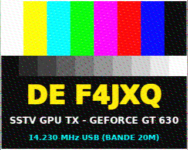

# 📻 SSTV Radio Transmitter & SDR via VGA RAMDAC (GPU DDS)

> **Experimental software-defined radio (SDR) project repurposing the digital-to-analog converter (RAMDAC) of an NVIDIA GeForce graphics card to transmit live SSTV images (Martin 1) in the HF amateur band (20m / 14.230 MHz USB).**

*🇫🇷 Version française disponible : [README.md](README.md) | Animations interactives : [illustrations.html](illustrations.html)*

This guide documents the complete architecture, experimental protocol, underlying mathematical foundations, as well as **all technical pitfalls encountered and their solutions** to ensure complete reproducibility of the testbench.



---

## 📑 Table of Contents

1. [Legal Warnings and Regulations](#-legal-warnings-and-regulations)
2. [Operating Principle](#-operating-principle)
3. [Recommended Hardware and Cabling](#-recommended-hardware-and-cabling)
4. [Installation and Prerequisites](#-installation-and-prerequisites)
5. [Step-by-Step Practical Guide](#-step-by-step-practical-guide)
   - [Step 1: X11 / Nouveau Video Output Setup](#step-1-x11--nouveau-video-output-setup)
   - [Step 2: RF Carrier Calibration (CW)](#step-2-rf-carrier-calibration-cw)
   - [Step 3: Automated SSTV Transmission and Decoding](#step-3-automated-sstv-transmission-and-decoding)
   - [Step 4: Decoding with QSSTV and Robot36](#step-4-decoding-with-qsstv-and-robot36)
6. [Detailed System Architecture](#-detailed-system-architecture)
   - [1. Architectural Design Choices (CPU vs GPU)](#1-why-this-architecture-genesis-of-design-choices)
   - [2. System Display Setup Script (setup_display.sh)](#2-what-does-the-system-display-setup-script-setup_displaysh-do)
   - [3. Main Python Transmission Engine (vga_sstv.py)](#3-what-does-the-main-python-script-vga_sstvpy-do)
   - [3b. High-Throughput C/C++ Render Engine (vga_tx_gpu)](#3b-role-of-the-high-throughput-cc-render-engine-vga_tx_gpu)
   - [4. VRAM Texture Organization](#4-what-does-the-vram-texture-contain)
   - [5. Role of GLSL Fragment Shaders](#5-what-do-the-gpu-fragment-shaders-glsl-do)
7. [The 8 Major Technical Pitfalls and Their Solutions](#-the-8-major-technical-pitfalls-and-their-solutions)
8. [Files and Project Organization](#-files-and-project-organization)
9. [Experimental Results and Performance](#-experimental-results-and-performance)

---

## ⚠️ Legal Warnings and Regulations

> [!CAUTION]
> **LEGAL FRAMEWORK AND HARDWARE SAFETY (ANFR / ITU-R / FCC REGULATIONS)**
>
> 1. **UNLICENSED TRANSMISSION ON AN ANTENNA IS STRICTLY PROHIBITED:**
>    Transmitting within amateur radio bands (e.g., 20m / 14.230 MHz, 6m / 50.100 MHz) is strictly restricted to licensed amateur radio operators holding an **official callsign** (e.g., F4JXQ).
>
> 2. **RECOMMENDED USE OF A DUMMY LOAD OR LOCAL COUPLING:**
>    For laboratory bench testing, use a **shielded 50 $\Omega$ dummy load** or an inline RF power attenuator ($-30\text{ dB}$ to $-40\text{ dB}$) connected directly to your SDR receiver. For over-the-air local lab testing without an attenuator, use exclusively two short wires (15 cm) placed in close proximity to the receiver antenna, without any power amplification.
>
> 3. **SPECTRAL PURITY AND LOW-PASS FILTERING:**
>    Digital-to-analog conversion via a RAMDAC produces staircase quantization artifacts and video line harmonic spurs ($f_H$). If an over-the-air transmission is performed by a licensed operator, a **5th- or 7th-order low-pass filter (Chebyshev or Butterworth topology)** cutting off sharply above 15 MHz is mandatory.

---

## 🧠 Operating Principle

A standard analog VGA display interface is driven by a **RAMDAC** (triple 8-bit red/green/blue DAC clocked by a dedicated hardware quartz oscillator, typically at **120.00 MHz** or **148.50 MHz**).

By executing an **OpenGL Fragment Shader (GLSL)** mapped across a full-screen viewport on the GPU compute cores, we calculate the instantaneous value of a radio frequency wave for every single pixel:
- Horizontal and vertical raster scanning transforms the spatial succession of display pixels into a continuous temporal stream of analog voltage samples on the physical **Red pin (Pin 1)** of the VGA connector.
- The **14.230 MHz** radio carrier is synthesized using **32-bit direct digital synthesis (DDS)** inside the shader.
- The SSTV audio signal (Martin 1) is modulated into **pure Upper Sideband (SSB / USB)** via a Cartesian quadrature mixer:
  $$\text{RF}(t) = I(t)\cos(\theta_c(t)) - Q(t)\sin(\theta_c(t))$$
  where $I(t)$ and $Q(t)$ are pre-computed baseband analytic components of the SSTV audio, loaded into VRAM inside a Float32 texture.

```
[ NVIDIA GT 630 GPU ]
  ├── CUDA / Compute Cores / Fragment Shader (32-bit DDS + USB I/Q Mixer)
  └── Video RAMDAC (120.00 MSPS or 148.50 MSPS / 8-bit DAC)
         ├── VGA Pin 1 (Red) ────────► RF Signal 14.230 MHz USB
         └── VGA Pin 6 (GND) ────────► RF Ground
```

---

## 🛠️ Recommended Hardware and Cabling

### Tested & Validated Hardware:
- **Transmitter GPU**: NVIDIA GeForce GT 630 (Fermi NVC1 / Kepler GK208 architecture) running Linux with the open-source `nouveau` driver.
- **SDR Receiver**: SDRplay RSP1 (14-bit, 250 kSps) or RTL-SDR v3/v4 dongle.
- **Physical Link**: Two 15 cm wire jumpers connected to Pin 1 (Red) and Pin 6 (GND) of the graphics card VGA connector, placed 20–30 cm away from the SDRplay telescopic antenna.

### VGA Connector Pinout (DE-15):
- **Pin 1**: Red Signal (RF output $0.0\text{V} - 0.7\text{V}$, $75\,\Omega$ source impedance)
- **Pin 6**: Red Ground (RF Ground)
- *(Optional)*: $75\,\Omega$ termination resistors to ground on Pin 2 (Green) and Pin 3 (Blue) help the graphics card detect display load if the driver refuses to enable the output without a connected monitor.

---

## 📦 Installation and Prerequisites

On transmitter and receiver machines (Debian / Ubuntu / Raspberry Pi):

```bash
# 1. System dependencies
sudo apt update
sudo apt install -y python3-pip python3-venv x11-xserver-utils libglfw3 libsoapysdr-dev soapysdr-module-all qsstv

# 2. Clone repository and set up Python virtual environment
git clone https://github.com/votre-depot/vga-hamradio.git
cd vga-hamradio
python3 -m venv .venv
source .venv/bin/activate
pip install -r requirements.txt

# 3. Build high-performance C/C++ native tools (SDR Capture & Deterministic GPU Scanout)
make all
# (Builds 'capture_iq' for SDRplay and 'vga_tx_gpu' for low-latency GPU scanout)
```

---

## 🚀 Step-by-Step Practical Guide

### Step 1: X11 / Nouveau Video Output Setup

The Nouveau driver requires that the analog output is marked as active (`connected`) and assigned a CRTC. The [`setup_display.sh`](./setup_display.sh) script configures display resolutions and timings:

```bash
# If the connector is reported as 'disconnected' by the kernel:
echo on | sudo tee /sys/class/drm/card0-VGA-1/status

# OPTION A (RECOMMENDED FOR RADIO): Custom Out-of-Band Mode (800x2000 @ 60Hz, f_H = 125 kHz)
# Pushes line blanking spurs completely outside the 20m band (fc + fH = 14.355 MHz > 14.350 MHz):
DISPLAY=:0 ./setup_display.sh -m 800

# OPTION B: Standard 1080p @ 60Hz Mode (1920x1080 @ 60Hz, f_H = 67.5 kHz, 148.50 MHz):
DISPLAY=:0 ./setup_display.sh -m 60
```
The script sets the gamma ramp to 1.0 (strict DAC linearity) and disables DPMS screen-saving power management.

---

### Step 2: RF Carrier Calibration (CW)

The onboard quartz crystal oscillator of graphics cards has slight manufacturing offsets (typically $+1\text{ ppm}$ to $+5\text{ ppm}$, corresponding to $+20$ to $+65\text{ Hz}$ at $14.230\text{ MHz}$).

1. Open your SDR application (**Gqrx**, **SDR#**, or **CubicSDR**) centered on **14.230000 MHz** in **CW** or **USB** mode.
2. Transmit a pure calibration carrier:
   ```bash
   DISPLAY=:0 python3 vga_sstv.py --cw -f 14.230e6 --duration 15.0
   ```
3. Note the exact peak frequency:
   - In 120 MHz mode (`-m 800`): **14.230062 MHz** ($+62\text{ Hz}$).
   - In 148.5 MHz mode (`-m 60`): **14.230034 MHz** ($+34\text{ Hz}$).
   This calibrated frequency is fed into the receiver baseband mixer for exact tuning.

---

### Step 3: Automated SSTV Transmission and Decoding

1. Generate the official high-visibility test pattern:
   ```bash
   # Default configuration (F4JXQ on 14.230 MHz USB, output: mire_f4jxq.png):
   python3 generate_test_card.py

   # Custom callsign configuration:
   python3 generate_test_card.py F4JXQ -f 14.230 -m USB
   ```

2. Run the end-to-end orchestration pipeline:
   ```bash
   # In Out-of-Band mode (800x2000 @ 120 MHz) using native C/C++ engine:
   python3 full_sstv_transmission_and_decode.py -c 14230062 --cpp

   # In standard 1080p mode (148.5 MHz):
   python3 full_sstv_transmission_and_decode.py -c 14230034 --cpp
   ```
   This script:
   - Spawns background SDRplay IQ capture at 250 kSps on $14.220\text{ MHz}$.
   - Triggers remote GPU SSTV transmission over SSH (delegating to deterministic native C engine `vga_tx_gpu` with `--cpp`).
   - At the conclusion of the 125-second transmission, demodulates USB baseband audio to [`sstv_audio_demod.wav`](./sstv_audio_demod.wav), decodes all 256 scanlines, and generates the final image [`image_recue.png`](./image_recue.png).

---

### Step 4: Decoding with QSSTV and Robot36

The demodulated audio stream strictly matches international amateur radio standards:

- **With QSSTV (Linux PC)**:
  1. Launch `qsstv`.
  2. Set audio input to your SDR receiver (via PulseAudio/PipeWire) or select **File ➔ Play audio file** and choose [`sstv_audio_demod.wav`](./sstv_audio_demod.wav).
  3. QSSTV automatically detects Martin 1 mode, locks onto the VIS digital header, and renders the color image with zero line slant or tear.
- **With Robot36 (Android Smartphone)**:
  1. Open the **Robot36** app on your phone.
  2. Start playback of the demodulated WAV file (`paplay sstv_audio_demod.wav`).
  3. The app synchronizes automatically via the VOX preamble and renders the image line-by-line.

---

## 🏛️ Detailed System Architecture

To repurpose a consumer graphics card into an SSB (USB) radio transmitter streaming 115 seconds of color SSTV video at 120 to 150 million samples per second, a hybrid architecture combining **CPU (high-fidelity pre-computation) + GPU (real-time synthesis and mixing)** was designed.

### 1. Why this architecture? (Genesis of design choices)

When synthesizing a radio signal at $14.230\text{ MHz}$:
1. **CPU-only limitations:** A general-purpose CPU under Linux cannot stream continuous analog samples at 150 MSPS without jitter. OS kernel scheduling (context switches, interrupt handling, cache misses) introduces microsecond pauses that destroy RF phase continuity.
2. **The power of hardware RAMDAC:** The GPU houses a dedicated digital-to-analog converter (RAMDAC), clocked by a hardware quartz crystal oscillator ($120.00\text{ MHz}$ or $148.50\text{ MHz}$). Once active, the RAMDAC scans video memory and generates analog signals in an uninterrupted, deterministic fashion, completely immune to host CPU load.
3. **Partitioning responsibilities (CPU vs GPU):**
   - **Computing everything in the GPU Shader** in real-time (scanline sequencing, color switching, synchronization porches, pixel modulation) would require complex conditional logic inside each fragment thread, inducing *branch divergence* and numerical precision loss over 115 seconds.
   - **Adopted solution:** The **CPU** pre-computes the complete baseband SSTV audio signal with maximum mathematical precision (64-bit float), then the **GPU** converts this audio into 14.230 MHz RF at its native hardware clock rate.

```
+-----------------------------------------------------------------------------+
|                                CPU (PYTHON)                                 |
|  1. 320x256 source test image (PIL)                                         |
|  2. Martin 1 encoding: VOX (1900Hz) + VIS (Code 44) + Lines (G, B, R)       |
|  3. Phase integration in float64 modulo 1.0 (zero jitter)                   |
|  4. Quadrature generation: I(t) = cos(φ), Q(t) = sin(φ)                     |
+--------------------------------------+--------------------------------------+
                                       |
                   VRAM Upload (RG32F 2D Texture)
                                       |
                                       v
+-----------------------------------------------------------------------------+
|                           GPU (GLSL FRAGMENT SHADER)                        |
|  1. gl_FragCoord.xy  ──►  sample_in_frame (integrates H_total/V_total porches)|
|  2. 32-bit DDS       ──►  Pure RF carrier: θ_c = frame_phase + n*Δθ         |
|  3. Texel Fetch      ──►  Bitwise indexing (& 2047u, >> 11)                 |
|  4. Linear Mix       ──►  Continuous I(t) and Q(t) interpolation             |
|  5. USB Mixer        ──►  RF(t) = I(t)*cos(θ_c) - Q(t)*sin(θ_c)             |
|  6. Temporal Dither  ──►  DAC = 0.5 + 0.5*RF + dither(u_frame_phase)        |
+--------------------------------------+--------------------------------------+
                                       |
                             Hardware RAMDAC Scanout
                                       v
          [ Physical Output: VGA Pin 1 (Red) + Pin 6 (Ground) ]
                    ──► 14.230 MHz USB RF Transmission ──►
```

---

### 2. What does the system display setup script (`setup_display.sh`) do?

Linux display drivers (`nouveau` or `nvidia`) and the X11 server are designed to render desktop GUIs, not act as RF transmitters. The [`setup_display.sh`](./setup_display.sh) script configures the hardware environment:
- **Forced VGA Output Activation:** If no physical monitor is attached (or only two wires), the Linux kernel marks the port as `disconnected`. The script forces the status to `on` via sysfs (`/sys/class/drm/card0-VGA-1/status`) to wake up the display controller.
- **Custom Modeline Injection:** Injects the exact video modeline via `xrandr` (e.g., `800x2000_125k` @ $120.00\text{ MHz}$ or `1920x1080_60.00` @ $148.50\text{ MHz}$) and binds it explicitly to CRTC 0.
- **Disabling Gamma Distortion:** By default, X11 applies a non-linear gamma curve ($\gamma \approx 2.2$) calibrated for human vision. In RF transmission, this curve would distort pure sine waves into severe harmonics! The script forces a **strictly linear 1.0 Gamma LUT** (`xrandr --gamma 1.0:1.0:1.0`).
- **Disabling DPMS Power Saving:** Disables screensavers and power management (`xset -dpms`, `xset s off`) to prevent the GPU from shutting down the RAMDAC mid-transmission.

---

### 3. What does the main Python script (`vga_sstv.py`) do?

The Python script orchestrates baseband synthesis and GPU rendering:
1. **Baseband SSTV Audio Generation (CPU):**
   - Loads the source card and samples each color scanline (Green, Blue, Red) at standard Martin 1 rate ($F_s = 48\text{ kHz}$).
   - Inserts the VOX preamble (500 ms @ 1900 Hz), VIS digital header (code 44), and horizontal sync pulses (1200 Hz).
   - Integrates instantaneous frequency in **double-precision `float64` modulo 1.0** to guarantee absolute phase continuity across 5.5 million samples.
2. **Quadrature Signal Construction ($I/Q$):**
   - Evaluates analytic Cartesian components: $I(t) = \cos(\phi_a(t))$ and $Q(t) = \sin(\phi_a(t))$.
   - Packs these samples into a two-channel Float32 (`f4`) NumPy array formatted for VRAM.
3. **OpenGL Frame Rendering Loop (GLFW / ModernGL):**
   - Allocates the viewport window with strict vertical synchronization (`swap_interval(1)`).
   - Disables garbage collection (`gc.disable()`) and moves console reporting to a background worker thread to prevent Python runtime pauses.
   - At each frame, computes absolute time progression in 64-bit integers (`frame_phase`, `u_audio_frame_base_int` and fractional residual `u_audio_frame_base_frac`), ensuring **zero clock drift** over the entire transmission.
4. **Texture Export and Native C Engine Integration (`vga_tx_gpu`):**
   - Ability to export pre-computed textures to `.sstvtex` binary container files (`--save-texture`).
   - Ability to delegate real-time scanout to the dedicated native C/C++ engine (`--cpp`) to eliminate interpreter and GC overhead.

---

### 3b. Role of the High-Throughput C/C++ Render Engine (`vga_tx_gpu`)

To completely eliminate Python runtime overhead, the GIL, and garbage collector pauses at high frame rates (> 100 Hz):
- **Pure C Execution (OpenGL 3.3 Core Profile + X11)**: per-frame render latency < 5 microseconds.
- **Linux Real-Time Scheduling Support (`SCHED_FIFO`)** via `--realtime` / `-r`.
- **Complete Feature Parity**: supports `.sstvtex` binary textures as well as pure CW carriers and test tones.

---

### 4. What does the VRAM texture contain?

To upload 5.5 million I/Q audio samples to the GPU:
- **2D Texture Layout:** The audio stream is folded into a 2D texture measuring **$2048 \times 2712$ pixels**.
- **`GL_RG32F` Format (Float32 dual-channel):**
  - **Red Channel (R)**: in-phase component $I(t) = \cos(\phi_{\text{audio}}(t))$.
  - **Green Channel (G)**: quadrature component $Q(t) = \sin(\phi_{\text{audio}}(t))$.
- **Memory Footprint:** The entire 115-second transmission takes **42.4 MB** of VRAM, with a 24-bit mantissa dynamic range (internal quantization noise floor at $-140\text{ dB}$).

---

### 5. What do the GPU Fragment Shaders (GLSL) do?

Three specialized shaders (`FRAGMENT_SHADER_CW`, `FRAGMENT_SHADER_TONE`, `FRAGMENT_SHADER_SSTV`) eliminate dynamic branch divergence:
1. **Spatial-to-Temporal Index Conversion:**
   Translates screen fragment position (`gl_FragCoord.xy`) into a continuous time index within the frame raster:
   $$\text{sample\_in\_frame} = (y_{\text{scan}} \times H_{\text{total}}) + x_{\text{scan}}$$
2. **Direct Digital Synthesis of the RF Carrier (32-bit DDS):**
   Advances carrier phase using an unsigned 32-bit accumulator (natural modulo $2^{32}$):
   $$\theta_c = (\text{u\_frame\_phase} + \text{sample\_in\_frame} \times \text{u\_phase\_inc}) \times \frac{2\pi}{2^{32}}$$
3. **Audio I/Q Extraction and Continuous Interpolation:**
   Computes texture addresses using single-cycle bitwise masks (`& 2047u`, `>> 11`), fetches adjacent texels $s_0$ and $s_1$ via `texelFetch`, and applies linear interpolation `mix(s0, s1, frac)`.
4. **Upper Sideband (USB) Quadrature Mixer:**
   Computes single-sideband modulation via Cartesian product:
   $$\text{RF}(t) = I(t)\cos(\theta_c) - Q(t)\sin(\theta_c) = \cos(\theta_c + \phi_{\text{audio}}(t))$$
5. **Temporal Dithering and DAC Output:**
   - Centers the RF signal within DAC range: $\text{dac} = 0.5 + 0.5 \times \text{RF}$.
   - Adds pseudo-random dither seeded by frame phase (`u_frame_phase`) to linearize the 8-bit converter.
   - Writes the value to the Red channel (`FragColor = vec4(dac, 0.0, 0.0, 1.0)`), physically driving **Pin 1 of the VGA port**.

---

## 🔬 The 8 Major Technical Pitfalls and Their Solutions

### 1. `float32` Mantissa Saturation in Audio Phase Accumulation
- **Symptom**: Violent frequency jumps and phase ruptures after a few seconds of transmission.
- **Cause**: At $48\text{ kHz}$, `np.cumsum(all_freqs / audio_fs)` in `float32` exceeds $2^{24}$ within seconds, exhausting mantissa precision and causing catastrophic phase rounding errors.
- **Solution**: Accumulate phase in **64-bit double precision (`float64`)** with strict modulo $1.0$ before converting to radians.

---

### 2. Geometry Detection Conflict Between GLFW and X11
- **Symptom**: Distorted audio speed, abnormal transmission rates, or window failing to open.
- **Cause**: When running non-1080p resolutions (e.g., 800x2000), hardcoding a 1920x1080 window induces Mesa scaling artifacts and sample clock mismatches.
- **Solution**: Implemented `detect_active_display_timings()` querying `xrandr` dynamically to automatically retrieve width, height, Pixel Clock, active $H_{\text{total}}$, and $V_{\text{total}}$.

---

### 3. Periodic 1-Second FFT Chunk Discontinuities in Receiver
- **Symptom**: Regular clicks and phase slippage occurring exactly every 1.000000 second in demodulated audio.
- **Cause**: Processing IQ streams in discrete 1-second chunks introduces circular convolution boundary discontinuities.
- **Solution**: Bandpass filtering performed in a **single continuous global FFT pass** over the entire 125-second IQ buffer.

---

### 4. Line Sync Pulse Detection and Horizontal Centering
- **Symptom**: Jagged sawtooth line offsets or image wrapped around with white borders on the left.
- **Cause**: Naive peak detection sensitive to thermal noise, and horizontal centering search window too narrow.
- **Solution**:
  1. Coherent 1200 Hz matched filter.
  2. Direct jump to Line 0 pulse immediately following the VIS stop bit (avoids false-locking on the 30 ms VIS bit).
  3. Robust linear regression (`np.polyfit`) across all detected sync pulses to lock a single slant slope.
  4. Expanded centering optimization window $[-1500, +1500]$ samples, locking the first white test bar precisely at $x = 0$.

---

### 5. Missed VIS Header on QSSTV / Robot36
- **Symptom**: QSSTV or Robot36 starts decoding mid-screen or fails mode auto-detection.
- **Cause**: Receiver AGC takes 100 to 300 ms to settle.
- **Solution**: Prepended a **500 ms VOX/AGC preamble at 1900 Hz** followed by a 10 ms break at 1200 Hz prior to the VIS header.

---

### 6. Fixed Spatial Dot Grid Artifacts (Spatial vs Temporal Dithering)
- **Symptom**: Stationary dot matrix pattern visible across dark image areas.
- **Cause**: Static spatial dithering depending only on `gl_FragCoord.xy`.
- **Solution**: Injected dynamic frame phase into the GLSL dither seed, converting spatial pattern noise into **dynamic temporal white noise**.

---

### 7. Text Blurring Due to Image Rescaling
- **Symptom**: Callsign illegible after decoding.
- **Cause**: Downsampling high-resolution images smoothed fine fonts and sharp edges.
- **Solution**: Rendered test pattern directly at **native Martin 1 resolution (320x256)** with high-contrast text halos.

---

### 8. Out-of-Band Harmonics vs Vertical Refresh Rate (The $800\times 2000$ Modeline Solution)
- **Symptom**:
  - In $800\times 600$ @ 201 Hz mode: GPU missed $0.5\%$ of vsyncs, accumulating $5100\text{ PPM}$ drift and **severe diagonal image slant**.
  - In $800\times 600$ extended 60 Hz mode with $V_{\text{total}}=2083$: 71% vertical blanking chopped the carrier at 60 Hz, creating thick black horizontal bars.
- **Cause**: To obtain $f_H = 125\text{ kHz}$ (pushing blanking spurs outside the 20m band), $V_{\text{total}}$ must equal $f_H / f_V = 125000 / 60 = 2083$. If active height is only 600 lines, the RAMDAC is shut down 71% of the time!
- **Solution**: Defined a custom active resolution of **2000 lines** ($800\times 2000$ @ 60 Hz):
  - $f_H = 125.000\text{ kHz}$ is preserved ($PCLK = 120.00\text{ MHz}$, $H_{\text{total}} = 960$).
  - $f_V = 60.01\text{ Hz}$ ($16.66\text{ ms}$/frame) provides ample rendering margin for the GPU -> **0 missed frames (0.0 %)**, zero image slant.
  - Useful RF duty cycle reaches **$96.0\%$** (blanking reduced to $4.0\%$, 60 Hz amplitude chopping eliminated).
  - The first upper line spur lands at **$14.355\text{ MHz}$**, strictly above the 20m band limit ($14.350\text{ MHz}$).

---

## 📁 Files and Project Organization

| File | Description |
| :--- | :--- |
| [`vga_sstv.py`](./vga_sstv.py) | **Main GPU Radio Transmitter**: Specialized GLSL shaders (CW, TONE, SSTV), 32-bit DDS, USB mixer, Float32 texture streaming, automatic timing detection, and zero-jitter real-time loop. |
| [`setup_display.sh`](./setup_display.sh) | CRTC configuration shell script: forces VGA port active, applies modelines ($800\times 2000$ Out-of-Band, $1024\times 2000$, or 1080p), disables DPMS, and enforces gamma 1.0. |
| [`capture_iq.cpp`](./capture_iq.cpp) | High-performance C++ streaming recorder via SoapySDR at 250 kSps (eliminates SDRplay USB buffer overflows). |
| [`decode_martin1.py`](./decode_martin1.py) | **Stand-alone SSTV Decoder**: Global continuous FFT, analytic FM discriminator, 1200 Hz matched filter, robust linear PLL, and horizontal centering $[-1500, +1500]$. |
| [`full_sstv_transmission_and_decode.py`](./full_sstv_transmission_and_decode.py) | Complete orchestrator: synchronizes SDRplay capture and remote GPU transmission over SSH, producing decoded image and fidelity metrics. |
| [`generate_test_card.py`](./generate_test_card.py) | Python generator for official 320x256 test pattern ([`mire_f4jxq.png`](./mire_f4jxq.png)). |
| [`illustrations.html`](./illustrations.html) | Interactive HTML5 demonstration application (French) with 5 real-time Canvas animated simulators. |
| [`illustrations.en.html`](./illustrations.en.html) | Interactive HTML5 demonstration application (English) with 5 real-time Canvas animated simulators. |
| [`CURRENT_STATE.md`](./CURRENT_STATE.md) | Technical synthesis, lab journal, and transmission mode comparison matrix. |
| [`DEEP-RESEARCH.md`](./DEEP-RESEARCH.md) | Comprehensive theoretical state-of-the-art analysis and prior art benchmarking. |
| [`DEEP-RESEARCH-REMARKS.md`](./DEEP-RESEARCH-REMARKS.md) | Critical evaluation of originality and documentation of the $800\times 2000$ modeline breakthrough. |
| [`requirements.txt`](./requirements.txt) | Python dependencies (`moderngl`, `glfw`, `numpy`, `pillow`, `scipy`). |

---

## 📊 Experimental Results and Performance

Measurements taken during complete 125-second over-the-air laboratory transmissions on **14.230 MHz USB**:

| Metric | Standard 1080p @ 60 Hz Mode | Recommended Out-of-Band $800\times 2000$ @ 60 Hz Mode |
| :--- | :---: | :---: |
| **Pixel Clock ($PCLK$)** | 148.50 MHz | **120.00 MHz** |
| **Horizontal Line Rate $f_H$** | 67.50 kHz | **125.000 kHz** |
| **Upper Spur ($f_c + f_H$)** | 14.2975 MHz *(Inside 20m band)* | **14.355 MHz *(Strictly outside 20m band)*** |
| **Lower Spur ($f_c - f_H$)** | 14.1625 MHz *(Inside 20m band)* | **14.105 MHz *(CW/digimodes sub-band)*** |
| **SSB Phone Sub-band Pollution** | Present ($\pm 67.5$ kHz spurs) | **Eliminated (100% clean in 14.150–14.350 MHz)** |
| **GPU Delayed Frames** | 0 (0.0 %) | **0 (0.0 %)** |
| **SSTV Image Slant** | **Zero (Slope = 0)** | **Zero (Slope = 0)** |
| **Peak Signal-to-Noise Ratio (PSNR)** | **19.56 dB** | **16.62 dB** |
| **Mean Squared Error (MSE)** | **720.1** | **1416.2** *(out of 65025)* |
| **Pearson Correlation (Green)** | **+0.977** (97.7 %) | **+0.959** (95.9 %) |
| **Pearson Correlation (Red)** | **+0.977** (97.7 %) | **+0.955** (95.5 %) |
| **Pearson Correlation (Blue)** | **+0.972** (97.2 %) | **+0.913** (91.3 %) |
| **Decoded Line Success Rate** | **256 / 256 lines (100.0 %)** | **256 / 256 lines (100.0 %)** |
| **Automated Recognition** | **100 % in QSSTV and Robot36** | **100 % in QSSTV and Robot36** |

---

## 73 de F4JXQ! 📻 Happy amateur radio experiments!

> ℹ️ **Editorial Transparency Note (EU AI Act Alignment):** This article was generated with AI assistance under the editorial direction and structuring of a human author, who assumes responsibility for its technical review, verification, and content (ongoing proofreading).
